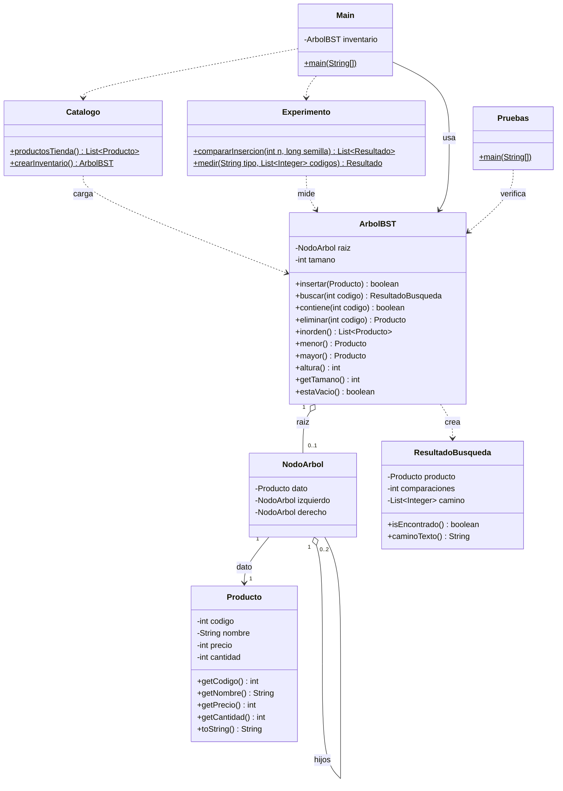

# Guía 7 – Reto integrador BST: sistema de inventario jerárquico

## Objetivo
Integrar inserción, búsqueda, eliminación y recorrido Inorden de un árbol binario de búsqueda (BST) en una aplicación Java de consola, validando entradas y analizando la complejidad de cada operación.

## Situación: inventario de la tienda de tecnología
Se reutiliza el catálogo de la [Guía 6](../06-catalogoInteligente/): una tienda de tecnología con 10 productos. Cada producto tiene **código, nombre, precio (COP) y cantidad en stock**, y el BST usa el **código como clave**. Al iniciar, el programa carga el catálogo y abre un menú para administrarlo.

## Estructura de la carpeta
```
07-Reto/
├── Producto.java           # modelo: código, nombre, precio, cantidad (valida sus datos)
├── NodoArbol.java          # nodo del BST (producto + hijo izquierdo y derecho)
├── ArbolBST.java           # BST por código: insertar, buscar, eliminar, inorden, menor, mayor, altura
├── ResultadoBusqueda.java  # producto encontrado + número de comparaciones + camino
├── Catalogo.java           # los 10 productos de la tienda (Guía 6)
├── Experimento.java        # inserción aleatoria vs ordenada
├── Main.java               # menú de consola con validación de entradas
├── Pruebas.java            # 48 pruebas automáticas
├── salida_pruebas.txt      # salida real de las pruebas
└── arbol_catalogo_productos.pdf  # diagrama del árbol inicial
```

## Cómo compilar y ejecutar
```bash
cd 07-Reto
javac -encoding UTF-8 *.java
java Main       # menú del inventario
java Pruebas    # pruebas automáticas
```

## Diagrama de clases


**Responsabilidades:**
- `Producto` solo conoce sus datos y rechaza valores inválidos (código ≤ 0, nombre vacío, precio o cantidad negativos).
- `ArbolBST` mantiene el invariante de orden (izquierda < nodo < derecha) y no permite códigos repetidos. No lee ni imprime nada.
- `Main` es la única clase que habla con el usuario: lee, valida y muestra resultados.
- `Catalogo`, `Experimento` y `Pruebas` usan el árbol sin conocer su implementación interna.

## Catálogo inicial
Orden de inserción: `50, 30, 70, 20, 40, 60, 80, 10, 35, 65`

| Código | Producto   | Precio (COP) | Cantidad |
|--------|------------|--------------|----------|
| 10     | USB 32GB   | 25.000       | 40       |
| 20     | Cable HDMI | 18.000       | 50       |
| 30     | Mouse      | 45.000       | 30       |
| 35     | Parlante   | 150.000      | 9        |
| 40     | Audífonos  | 120.000      | 18       |
| 50     | Teclado    | 85.000       | 14       |
| 60     | Webcam     | 95.000       | 11       |
| 65     | Router     | 130.000      | 12       |
| 70     | Monitor    | 620.000      | 6        |
| 80     | Impresora  | 480.000      | 4        |

```
                Teclado(50)
              /             \
        Mouse(30)            Monitor(70)
        /       \            /         \
 Cable HDMI(20) Audífonos(40) Webcam(60) Impresora(80)
      /             /              \
 USB 32GB(10)  Parlante(35)      Router(65)
```
Altura: **4 niveles**, así que ninguna búsqueda en este catálogo hace más de 4 comparaciones.

## Menú
```
1. Registrar producto
2. Buscar producto
3. Eliminar producto
4. Listar inventario (Inorden)
5. Producto de menor y mayor código
6. Prueba de inserción aleatoria vs ordenada
0. Salir
```

| Opción | Qué hace | Validaciones |
|--------|----------|--------------|
| 1. Registrar | Pide código, nombre, precio y cantidad e inserta el producto en el BST | Código entre 1 y 1.000.000; **si el código ya existe se rechaza antes de pedir el resto**; nombre no vacío; precio y cantidad ≥ 0 |
| 2. Buscar | Muestra el producto, **el número de comparaciones** y el camino recorrido | Si el código no existe lo informa, junto con las comparaciones que hizo para descubrirlo |
| 3. Eliminar | Elimina por código (hoja, un hijo o dos hijos con sucesor inorden) | Si el código no existe, no modifica nada |
| 4. Listar | Recorrido Inorden: inventario ordenado por código, altura y valor total | Inventario vacío |
| 5. Menor / mayor | Nodo más a la izquierda y nodo más a la derecha | Inventario vacío |
| 6. Prueba de inserción | Compara un árbol con inserción aleatoria y otro con inserción ordenada | n entre 10 y 5000 |
| — | — | En cualquier opción, si se escribe texto donde va un número o un valor fuera de rango, se muestra el error y se vuelve a pedir |

Ejemplo de búsqueda:
```
Código a buscar: 65
Encontrado: 65 - Router - $130.000 COP - stock: 12
Comparaciones: 4 | Camino: 50 -> 70 -> 60 -> 65 | Altura del árbol: 4

Código a buscar: 66
No existe un producto con el código 66.
Comparaciones: 4 | Camino: 50 -> 70 -> 60 -> 65 | Altura del árbol: 4
```

## Análisis de complejidad (Big O)
*n* = número de productos y *h* = altura del árbol. Todas las operaciones de búsqueda bajan por **un solo camino** desde la raíz, así que su costo depende de *h*, no de *n*:
- Árbol balanceado o aleatorio: h ≈ log₂ n → **O(log n)**
- Árbol degenerado (códigos insertados ya ordenados): h = n → **O(n)**

| Operación | Método | Mejor caso | Caso promedio | Peor caso | Espacio extra | Por qué |
|-----------|--------|-----------|---------------|-----------|---------------|---------|
| Registrar | `insertar` | O(1) | O(log n) | O(n) | O(1) | Baja un camino hasta un hueco libre; si encuentra el código, se detiene (duplicado) |
| Validar duplicado | `contiene` | O(1) | O(log n) | O(n) | O(1) | Es una búsqueda |
| Buscar | `buscar` | O(1) | O(log n) | O(n) | O(h) | Una comparación por nivel; el camino guardado mide h |
| Eliminar | `eliminar` | O(1) | O(log n) | O(n) | O(h) | Buscar el nodo + buscar el sucesor en el mismo subárbol; recursión de profundidad h |
| Listar Inorden | `inorden` | O(n) | O(n) | O(n) | O(n) | Visita todos los nodos una vez; la lista resultante tiene n productos |
| Menor código | `menor` | O(1) | O(log n) | O(n) | O(1) | Baja solo por la izquierda |
| Mayor código | `mayor` | O(1) | O(log n) | O(n) | O(1) | Baja solo por la derecha |
| Altura | `altura` | O(n) | O(n) | O(n) | O(h) | Debe revisar todos los nodos |
| Tamaño | `getTamano` | O(1) | O(1) | O(1) | O(1) | Contador que se actualiza al insertar y eliminar |

**Aplicado a este inventario:** con 10 productos y altura 4, cualquier búsqueda, registro o eliminación hace como máximo 4 comparaciones, frente a las 10 que haría en el peor caso una búsqueda lineal en una lista. Si la tienda creciera a 1000 productos insertados en orden aleatorio, una búsqueda costaría unas 13 comparaciones en promedio. Pero si los códigos se registraran en orden (1, 2, 3, ...), el árbol se volvería una lista y costaría unas 500.

## Prueba: inserción aleatoria vs ordenada
`Experimento` inserta los códigos 1..n en orden y los mismos códigos barajados (semilla 42), y busca cada código para contar las comparaciones. Resultados reales:

| n | Inserción | Altura | Comparaciones promedio (búsqueda exitosa) | Comparaciones (código inexistente n+1) | log₂ n |
|------|-----------|--------|---------|-------|------|
| 100  | Aleatoria | 14     | 7,76    | 4     | 6,64 |
| 100  | Ordenada  | 100    | 50,50   | 100   | 6,64 |
| 1000 | Aleatoria | 27     | 13,40   | 8     | 9,97 |
| 1000 | Ordenada  | 1000   | 500,50  | 1000  | 9,97 |
| 5000 | Aleatoria | 26     | 14,69   | 10    | 12,29 |
| 5000 | Ordenada  | 5000   | 2500,50 | 5000  | 12,29 |

**Interpretación:**
- Con **inserción ordenada** cada código es mayor que todos los anteriores, así que siempre se cuelga a la derecha. El árbol degenera en una lista enlazada: altura = n y el promedio es exactamente (n + 1) / 2. Es el peor caso, **O(n)**.
- Con **inserción aleatoria** la altura crece muy despacio (27 para 1000 productos) y el promedio queda cerca de 1,39·log₂ n, el valor esperado para un BST aleatorio. Es el caso **O(log n)**.
- Pasar de 1000 a 5000 productos multiplica por 5 el costo del árbol ordenado, pero apenas cambia el del árbol aleatorio. Por eso conviene no cargar el inventario con códigos ya ordenados, o usar un árbol autobalanceado (AVL o rojo-negro).

## Pruebas realizadas (48/48 correctas)
Las pruebas están en `Pruebas.java` y su resultado en [`salida_pruebas.txt`](salida_pruebas.txt):
1. **Carga y registro:** se cargan 10 productos, la altura es 4, Inorden queda ordenado, se registra un código nuevo y un **código duplicado se rechaza** sin cambiar el tamaño ni el producto original.
2. **Búsqueda:** número exacto de comparaciones y camino para un código existente (65), para la raíz y para **códigos inexistentes** (66 y 1); ninguna búsqueda supera la altura.
3. **Menor y mayor código:** 10 y 80.
4. **Eliminación:** hoja (10), nodo con un hijo (60), nodo con dos hijos (30, lo reemplaza el sucesor 35), la raíz (50, lo reemplaza el 65), código inexistente (99) y nuevo registro de un código eliminado. Inorden sigue ordenado al final.
5. **Árbol vacío:** buscar, menor, mayor, eliminar, Inorden y altura no lanzan errores. Eliminar los 10 productos deja el árbol vacío.
6. **Validación de datos:** se rechazan código 0 o negativo, nombre vacío y precio o cantidad negativos; cantidad 0 sí es válida (producto agotado).
7. **Inserción aleatoria vs ordenada:** la ordenada tiene altura n y promedio (n + 1) / 2; la aleatoria tiene altura menor que 50 y menos de 20 comparaciones en promedio.

## Evidencias del menú
Agregar aquí las capturas de pantalla (o el enlace al video) del menú funcionando en VS Code: registrar, código duplicado, buscar uno existente y uno inexistente, eliminar, listar Inorden, menor y mayor, y la prueba de inserción.
