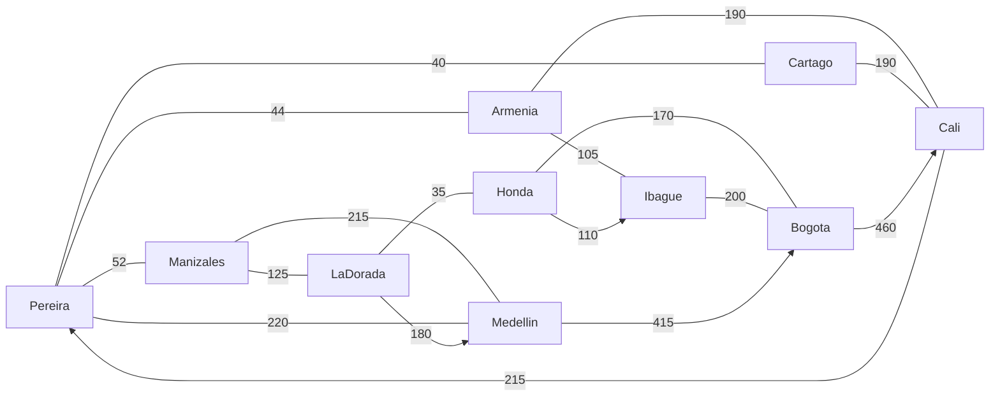

# Guía 12 – Introducción a grafos y redes complejas

**Asignatura:** Estructura de Datos II · Ingeniería de Software / Sistemas · Semestre IV
**Ecosistema:** Java / GitHub

## 1. Dominio y abstracción del problema

**Dominio elegido: transporte terrestre.** Se modela una red de rutas entre 10 ciudades del centro-occidente de Colombia.

| Elemento del grafo | Qué representa en el problema |
|---|---|
| Vértice | Una ciudad (terminal de transporte) |
| Arista no dirigida | Carretera de doble vía: se recorre en ambos sentidos |
| Arista dirigida | Ruta expresa de un solo sentido |
| Peso | Distancia aproximada por carretera, en km (valores referenciales) |

## 2. Tabla de vértices (|V| = 10)

| N° | Ciudad | Departamento | Grado (aristas incidentes) | Grado salida | Grado entrada |
|---|---|---|---|---|---|
| 1 | Pereira | Risaralda | 5 | 4 | 5 |
| 2 | Armenia | Quindío | 3 | 3 | 3 |
| 3 | Manizales | Caldas | 3 | 3 | 3 |
| 4 | Cartago | Valle del Cauca | 2 | 2 | 2 |
| 5 | Cali | Valle del Cauca | 4 | 3 | 3 |
| 6 | Ibagué | Tolima | 3 | 2 | 3 |
| 7 | Medellín | Antioquia | 4 | 3 | 3 |
| 8 | La Dorada | Caldas | 3 | 3 | 2 |
| 9 | Honda | Tolima | 3 | 3 | 2 |
| 10 | Bogotá | Cundinamarca | 4 | 3 | 3 |

## 3. Tabla de aristas (|A| = 17)

| N° | Origen | Destino | Peso (km) | ¿Dirigida? | ¿Ponderada? |
|---|---|---|---|---|---|
| 1 | Pereira | Armenia | 44 | No | Sí |
| 2 | Pereira | Manizales | 52 | No | Sí |
| 3 | Pereira | Cartago | 40 | No | Sí |
| 4 | Armenia | Ibagué | 105 | No | Sí |
| 5 | Armenia | Cali | 190 | No | Sí |
| 6 | Cartago | Cali | 190 | No | Sí |
| 7 | Manizales | Medellín | 215 | No | Sí |
| 8 | Pereira | Medellín | 220 | No | Sí |
| 9 | Manizales | La Dorada | 125 | No | Sí |
| 10 | La Dorada | Honda | 35 | No | Sí |
| 11 | Honda | Bogotá | 170 | No | Sí |
| 12 | Ibagué | Bogotá | 200 | No | Sí |
| 13 | Medellín | Bogotá | 415 | **Sí** | Sí |
| 14 | Bogotá | Cali | 460 | **Sí** | Sí |
| 15 | Cali | Pereira | 215 | **Sí** | Sí |
| 16 | La Dorada | Medellín | 180 | **Sí** | Sí |
| 17 | Honda | Ibagué | 110 | **Sí** | Sí |

## 4. Diagrama del grafo

El diagrama debe dibujarse en **Draw.io** o **Miro** y exportarse como imagen (`diagrama.png`) a esta carpeta. Para no empezar desde cero, el siguiente código Mermaid se puede pegar en Draw.io (*Organizar → Insertar → Avanzado → Mermaid*). Las líneas sin flecha son no dirigidas; las flechas son dirigidas.



## 5. Clasificación formal y justificación

**G = (V, A)** con |V| = 10 y |A| = 17.

| Característica | Resultado | Justificación |
|---|---|---|
| Dirección | **Mixto** | 12 aristas son no dirigidas (doble vía) y 5 son dirigidas (expresos de un solo sentido). |
| Ponderación | **Ponderado** | Cada arista tiene un peso positivo: la distancia en km. |
| Conectividad | **Conexo** (y fuertemente conexo) | Ignorando el sentido, existe camino entre todo par de ciudades; respetando el sentido, también, porque los arcos dirigidos no aíslan ningún vértice. |
| Ciclos | **Cíclico** | Existe al menos un ciclo (ver ejercicio 2). |
| Densidad | **Disperso** | D = 29 / (10·9) = **0.322**, menor que 0.5 (ver ejercicio 3). |

## 6. Ejercicios

### Ejercicio 1 – Convertir el grafo no dirigido en dirigido

Método `Grafo.convertirADirigido()`. Cada arista no dirigida (u, v) se reemplaza por dos aristas dirigidas u → v y v → u, con el mismo peso. El grafo pasa de 17 a **29 aristas**, todas dirigidas.

**Cambio semántico:** una arista no dirigida expresa una relación simétrica (una sola carretera que sirve en ambos sentidos). Al dirigirla, cada sentido pasa a ser una relación independiente: se puede asignar un peso distinto a la ida y a la vuelta (por ejemplo, por pendiente o peajes), cerrar un solo sentido, y los grados se separan en entrada y salida.

### Ejercicio 2 – Ciclo en el grafo

Sí existe. El programa encuentra (DFS) el ciclo:

`Pereira → Armenia → Ibagué → Bogotá → Honda → La Dorada → Manizales → Pereira`

También existe un ciclo dirigido de 4 vértices: `Medellín → Bogotá → Cali → Pereira → Medellín` (aristas 13, 14, 15 y 8).

### Ejercicio 3 – ¿Denso o disperso?

Con arcos reales = 12·2 + 5 = 29 y n = 10:

D = 29 / (n·(n−1)) = 29 / 90 ≈ **0.322**

Como D < 0.5, el grafo es **disperso**: solo existe alrededor de un tercio de las rutas posibles. Es lo esperado en una red de carreteras, donde cada ciudad se conecta únicamente con sus vecinas.

## 7. Estructura del código

| Archivo | Responsabilidad |
|---|---|
| `Vertice.java` | Ciudad: nombre y departamento. |
| `Arista.java` | Ruta: origen, destino, peso y si es dirigida (código base de la guía, con validaciones). |
| `Grafo.java` | Lista de adyacencia, grados, densidad, conectividad (BFS), ciclos (DFS) y conversión a dirigido. |
| `Main.java` | Construye la red y muestra tablas, clasificación y ejercicios. |

## 8. Compilar y ejecutar

```bash
javac -encoding UTF-8 -d out *.java
java -Dfile.encoding=UTF-8 -Dstdout.encoding=UTF-8 -cp out Main
```

Requiere JDK 17 o superior. Si en Windows los tildes se ven mal en la consola, ejecute antes `chcp 65001`.

## 9. Entrega en GitHub

```bash
git init
git add .
git commit -m "Guía 12: introducción a grafos (transporte)"
git branch -M main
git remote add origin https://github.com/<usuario>/12-introduccion-grafos.git
git push -u origin main
```

Subir a Moodle: diagrama, tablas (este README), clasificación justificada y el enlace al repositorio.

> Las distancias son aproximadas y referenciales; el objetivo de la guía es el modelado, no la precisión cartográfica.
